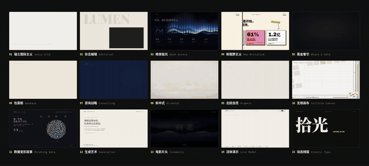
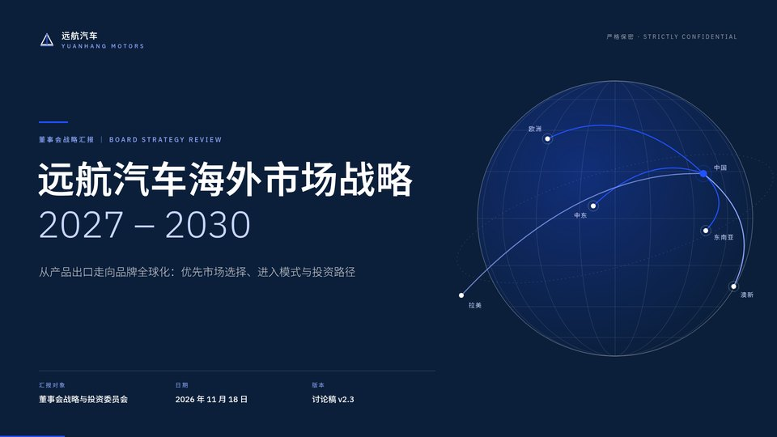
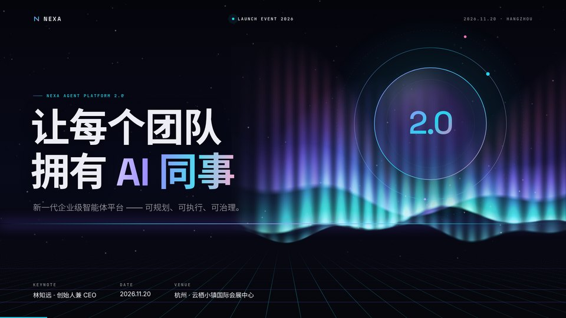
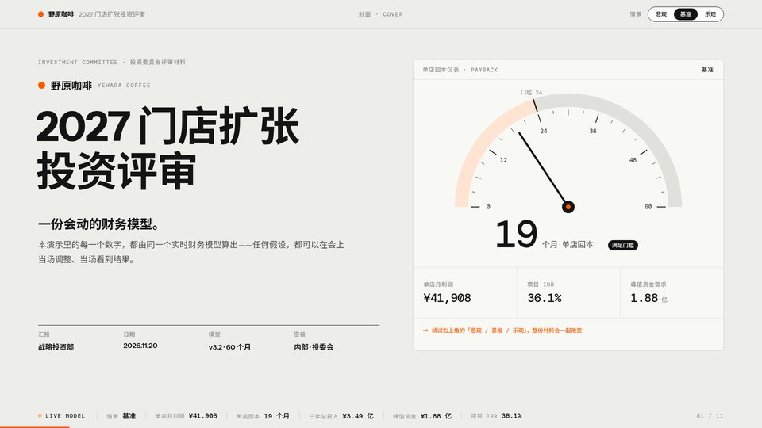
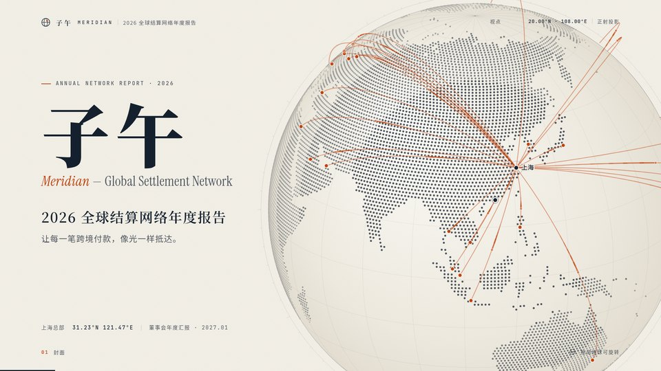
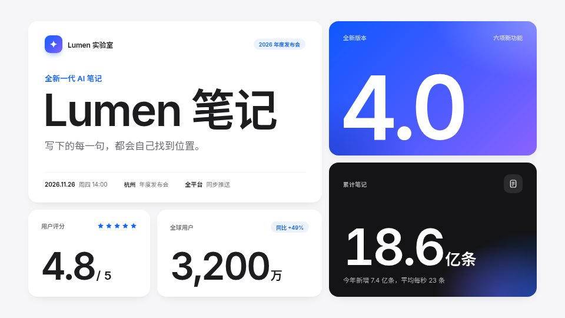
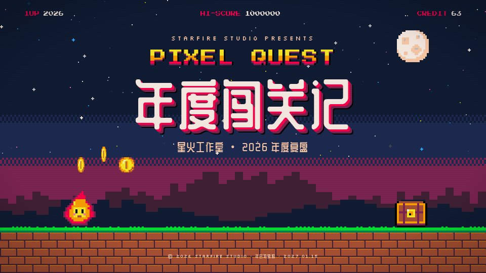
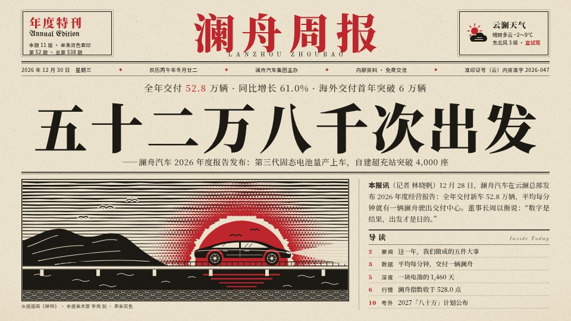
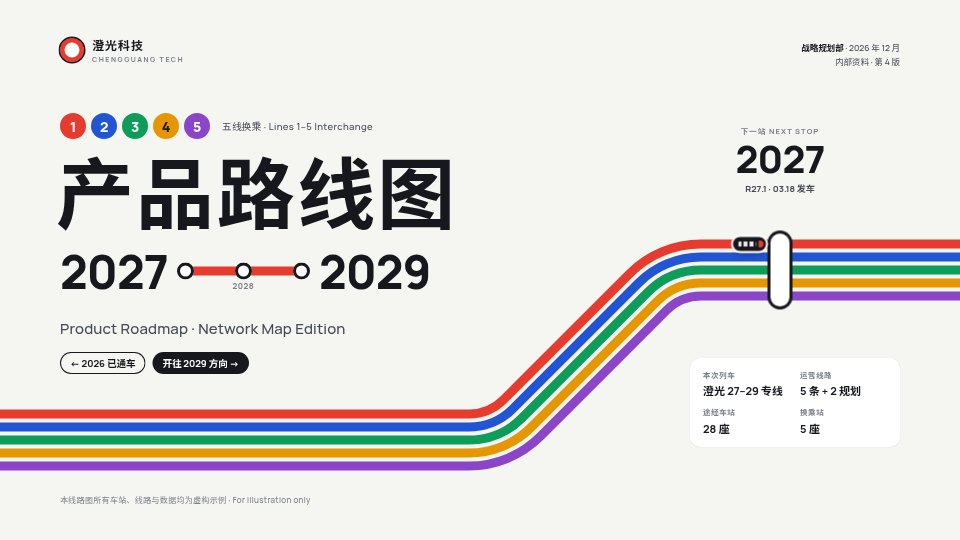

# lanshu-html-ppt-templates

**30 套专业 HTML 演示模板 · 338 页完整示例 · 一个可复用的 AI Skill**

[](https://ppt.lanshuagent.com/)
[](https://github.com/cclank/lanshu-html-ppt-templates/actions/workflows/check.yml)
[](LICENSE)
[](#模板目录)
[](#模板目录)
[](SKILL.md)
[](#直接使用模板)
[](#cloudflare-部署)
[](https://x.com/LufzzLiz)

从咨询报告、融资路演到数据变形和实时模型，把内容、设计与交互放进一个 HTML 文件。直接选模板改稿，也可以将整套资源安装为 Skill，让 AI 助手完成选型、内容改写和演示制作。

**[GitHub 源码](https://github.com/cclank/lanshu-html-ppt-templates)** · **[在线浏览全部模板](https://ppt.lanshuagent.com/)** · **[下载完整 Skill 与源码](https://github.com/cclank/lanshu-html-ppt-templates/releases/latest/download/lanshu-html-ppt-templates.zip)** · **[使用指南](https://ppt.lanshuagent.com/guide.html)** · **[在 X 关注岚叔](https://x.com/LufzzLiz)**

## 动态宫格总览

**两组宫格，一支 24 秒完整视频。** 前 12 秒展示 01—15 套，后 12 秒展示 16—30 套，呈现真实的转场、图表动画、Canvas 绘制与参数联动。

[](https://ppt.lanshuagent.com/media/lanshu-templates-showcase-v3.mp4)

**[观看 1920×864 高清视频 ↗](https://ppt.lanshuagent.com/media/lanshu-templates-showcase-v3.mp4)** · **[在线循环预览 ↗](https://ppt.lanshuagent.com/)**

动图预览随仓库和下载包一起提供。在线首页支持静音循环与暂停，鼠标移到模板卡片上还能单独预览每一套。高清视频和 30 段卡片预览不进入版本库，可通过 `python3 scripts/fetch_previews.py` 按 [preview-media.json](preview-media.json) 从站点校验下载；`scripts/deploy.py` 发布前会先执行这一步。

## 设计预览

点击封面进入完整演示。

| 咨询战略 · Consulting | 暗夜极光 · Dark Aurora |
|---|---|
| [](https://ppt.lanshuagent.com/07-consulting.html) | [](https://ppt.lanshuagent.com/03-aurora.html) |
| **活体演示 · Live Model** | **地球仪叙事 · Globe Narrative** |
| [](https://ppt.lanshuagent.com/14-live-model.html) | [](https://ppt.lanshuagent.com/20-globe.html) |
| **便当格 · Bento Grid** | **像素闯关 · Pixel Quest** |
| [](https://ppt.lanshuagent.com/22-bento.html) | [](https://ppt.lanshuagent.com/25-pixel.html) |
| **报纸头版 · Broadsheet** | **地铁线路 · Transit Map** |
| [](https://ppt.lanshuagent.com/26-newspaper.html) | [](https://ppt.lanshuagent.com/29-metro.html) |

## 项目亮点

- **30 种完整风格**：15 套经典系列、15 套交互实验，每套 10–12 页，包含正文结构与逐页演讲备注。
- **单文件交付**：原生 HTML / CSS / JavaScript，字体内嵌。模板播放无需安装依赖、账号、后端或 API 密钥。
- **更丰富的表达**：SVG 图表、Canvas 数据变形、生成艺术、空间视差、镜头飞行和可调业务模型。
- **完整放映体验**：1920×1080 画布自适应缩放，支持翻页、全屏、页码跳转、总览和演讲者窗口；30 套都内置激光笔、画笔批注、黑白屏和快捷键面板，还能用手机扫码遥控。
- **浏览器里直接改稿**：按 `E` 进入编辑，点文字就能改；讲稿、标题、全套替换和主题色都在侧边面板里，改完另存为新文件。联网时用 `scripts/embed_fonts.py` 为新写的字补全内嵌字体。
- **Skill 与工具一起交付**：选型目录、创作规则、模板复制、静态校验和安全安装器均包含在完整包中。
- **可重复构建和部署**：标准库 Python 脚本构建静态站点和 ZIP，Cloudflare Workers Static Assets 托管全部模板。

### 本次更新

- 新增 21–30 号共 10 套模板，模板库扩展到 30 套、338 页。
- 首页加入 72 秒新功能介绍，开头两页动态宫格，每页 5 套，并演示浏览器改稿。
- 新增“新增 10 套”筛选和新增标记；全部 30 套支持卡片悬停动态预览。
- 按 `E` 直接改文字、讲稿和主题色，改完另存为 HTML；手机遥控与完整放映工具见使用指南。

## 直接使用模板

1. 打开 [在线模板目录](https://ppt.lanshuagent.com/)，选择适合的风格。
2. 点击封面放映，或点击“下载 HTML”保存单文件。
3. 使用文本编辑器或 AI 助手改写页面内容和演讲备注，再用浏览器打开。

完整包中的原始模板位于 `assets/templates/`，封面预览位于 `assets/thumbs/`。下载到本地的模板可离线放映。

| 操作 | 方式 |
|---|---|
| 翻页 | `←` / `→`、PageUp / PageDown；模板还支持点击、滚轮或触屏手势 |
| 全屏 | `F` |
| 演讲者视图 | `S`，首次使用时允许本页弹窗 |
| 总览 | `O`，30 套均可用 |
| 跳到某页 | 输入页码后按 `Enter`；或在文件或网址后加 `#页码`，如 `07-consulting.html#3` |
| 黑屏 / 白屏 | `B` / `W`，再按一下恢复；翻页笔的黑屏键同样有效 |
| 激光笔 | `L` |
| 画笔批注 | `D` 开关，`C` 清除本页，`Ctrl+Z` 撤销；批注按页保留，刷新后清空 |
| 手机遥控 | `M`，需要通过 `scripts/present.py` 打开，见下文 |
| 编辑与换色 | `E`：点文字直接改，侧边面板改讲稿、全套替换、调主题色；`Ctrl+S` 另存为新文件 |
| 全部快捷键 | `?` |
| PDF | 对带多页打印样式的模板，使用浏览器打印到 PDF；启用“背景图形”，边距选“无” |

### 手机遥控

用随附的本地放映服务打开演示，就能用手机扫码遥控：翻页、看逐页讲稿、跳页、黑屏，也能在手机上使用激光笔和画笔。只需要 Python 3，不用安装依赖。

```bash
python3 scripts/present.py                         # 放映 assets/templates 中的全部模板
python3 scripts/present.py outputs/strategy.html   # 放映自己的演示
```

浏览器打开演示后按 `M`，用手机相机扫描屏幕上的二维码。手机和电脑需要连同一个 Wi‑Fi；首次运行时如果系统询问，请允许 Python 接受局域网连接。服务运行期间，同一网络中的设备可以访问被放映的文件夹；按 `Ctrl+C` 停止。

### 在浏览器里改稿

打开任意一套模板，按 `E` 进入编辑模式：

1. 点击页面上带虚线框的文字，直接修改；
2. 在“文字与讲稿”面板里改本页讲稿和浏览器标题，用“全套替换”把样例里的公司名、产品名一次换掉（讲稿里的也一起换）；
3. 在“配色”面板里用取色器调整这套模板的主题色，实时预览；
4. 点“保存为新文件”或按 `Ctrl+S`，得到 `原文件名（已编辑）.html`，原文件不会被改动。直接双击打开的文件，保存时需要再选一次原文件。

新写的字如果不在内嵌字体里，会先用系统字体显示，编辑面板会列出这些字。联网时运行下面的命令，按页面上实际用到的字重新裁剪内嵌字体：

```bash
python3 scripts/embed_fonts.py "我的演示（已编辑）.html"
```

## 安装为 Skill

从 GitHub 克隆，或下载并解压 [完整包](https://github.com/cclank/lanshu-html-ppt-templates/releases/latest/download/lanshu-html-ppt-templates.zip)。安装需要 Python 3.10+，不需要安装 Python 第三方依赖。

```bash
git clone https://github.com/cclank/lanshu-html-ppt-templates.git
cd lanshu-html-ppt-templates
python3 scripts/install.py
```

默认安装到 `~/.codex/skills/lanshu-html-ppt-templates`；设置了 `CODEX_HOME` 时使用该目录下的 `skills/`。安装器只复制 Skill 必需资源，并拒绝覆盖已有目录。

为其他支持 SKILL.md 的助手指定技能目录：

```bash
python3 scripts/install.py --skills-dir /path/to/your/skills
```

安装后重新打开助手的新聊天，以刷新技能发现。示例提示：

```text
使用 $lanshu-html-ppt-templates，
把下面的内容做成 12 页产品发布演示。
受众是企业客户，采用暗夜极光风格，
输出单文件 HTML，并写好逐页演讲备注。

[粘贴你的材料]
```

Skill 会根据内容与格式要求选择模板，复制完整资源，改写页面和备注，执行静态检查，并在可用浏览器中验证实际呈现。

## 命令行工具

在项目目录运行；模板创建与源码查看使用 Python 3.10+，JavaScript 语法校验还需要 Node.js。开发和部署建议使用 Node.js 22+。

```bash
# 查看模板；筛出具有多页打印样式的模板
python3 scripts/deck.py list
python3 scripts/deck.py list --pdf

# 创建完整副本，不覆盖已有文件
python3 scripts/deck.py new 07-consulting \
  --output outputs/strategy.html \
  --title "年度业务战略"

# 阅读精简源码：仅隐藏终端输出中的字体 Base64，原文件保持完整
python3 scripts/deck.py source 07-consulting

# 检查页面结构、备注和 JavaScript 语法
python3 scripts/deck.py inspect outputs/strategy.html
python3 scripts/deck.py validate outputs/strategy.html

# 改完文字后联网补全内嵌字体（按页面实际用到的字重新裁剪）
python3 scripts/embed_fonts.py outputs/strategy.html
```

`--title` 仅修改浏览器标题；封面、正文、品牌、图表和备注需要继续编辑。详细步骤见 [作者指南](references/authoring.md)。

## 模板目录

“打印样式”表示源码内已有多页打印适配，PDF 实际效果仍需验证。交互、动画和临时状态应在浏览器中查看。

| ID | 风格 | 页数 | 适合场景 | 打印样式 |
|---|---|---:|---|---|
| [01-swiss](https://ppt.lanshuagent.com/01-swiss.html) | 瑞士国际主义 · Swiss Grid | 10 | 设计系统 / 商业汇报 / 产品说明 | 多页 |
| [02-editorial](https://ppt.lanshuagent.com/02-editorial.html) | 杂志编辑 · Editorial | 12 | 趋势报告 / 品牌故事 / 生活方式 | 多页 |
| [03-aurora](https://ppt.lanshuagent.com/03-aurora.html) | 暗夜极光 · Dark Aurora | 12 | AI 产品 / 技术发布 / 产品发布会 | 多页 |
| [04-brutalism](https://ppt.lanshuagent.com/04-brutalism.html) | 新粗野主义 · Neo-Brutalism | 12 | 融资路演 / 创业项目 / 年轻品牌 | 多页 |
| [05-luxury](https://ppt.lanshuagent.com/05-luxury.html) | 黑金奢华 · Black & Gold | 11 | 高端品牌 / 年度展望 / 客户提案 | 多页 |
| [06-bauhaus](https://ppt.lanshuagent.com/06-bauhaus.html) | 包豪斯 · Bauhaus | 11 | 设计课程 / 工作坊 / 创意教育 | 多页 |
| [07-consulting](https://ppt.lanshuagent.com/07-consulting.html) | 咨询战略 · Consulting | 12 | 战略汇报 / 经营分析 / 董事会材料 | 多页 |
| [08-oriental](https://ppt.lanshuagent.com/08-oriental.html) | 新中式 · Oriental | 12 | 文旅策展 / 文化项目 / 中式品牌 | 多页 |
| [09-organic](https://ppt.lanshuagent.com/09-organic.html) | 北欧自然 · Organic | 12 | ESG 报告 / 生活方式 / 可持续发展 | 多页 |
| [10-masterplan](https://ppt.lanshuagent.com/10-masterplan.html) | 无限画布 · Infinite Canvas | 11 | 战略全景 / 项目规划 / 空间叙事 | 浏览器放映 |
| [11-morph](https://ppt.lanshuagent.com/11-morph.html) | 数据变形叙事 · Morphing Data | 10 | 数据报告 / 人群洞察 / 研究分享 | 浏览器放映 |
| [12-generative](https://ppt.lanshuagent.com/12-generative.html) | 生成艺术 · Generative | 11 | 艺术展览 / 创意科技 / 算法演示 | 浏览器放映 |
| [13-cinematic](https://ppt.lanshuagent.com/13-cinematic.html) | 电影片头 · Cinematic | 12 | 品牌纪录 / 活动开场 / 故事提案 | 浏览器放映 |
| [14-live-model](https://ppt.lanshuagent.com/14-live-model.html) | 活体演示 · Live Model | 11 | 情景测算 / 投资评审 / 经营模型 | 多页 |
| [15-kinetic](https://ppt.lanshuagent.com/15-kinetic.html) | 动态排版 · Kinetic Type | 11 | 品牌焕新 / 宣言发布 / 文字叙事 | 多页 |
| [16-spatial](https://ppt.lanshuagent.com/16-spatial.html) | 空间界面 · Spatial UI | 11 | 硬件发布 / 空间计算 / 概念设计 | 浏览器放映 |
| [17-terminal](https://ppt.lanshuagent.com/17-terminal.html) | 终端即演示 · Terminal | 12 | 开发者大会 / 开源项目 / 技术分享 | 浏览器放映 |
| [18-riso](https://ppt.lanshuagent.com/18-riso.html) | 孔版印刷 · Risograph | 10 | 艺术书展 / 独立出版 / 文化活动 | 多页 |
| [19-collage](https://ppt.lanshuagent.com/19-collage.html) | 桌面拼贴 · Desk Collage | 11 | 创意比稿 / 营销提案 / 产品故事 | 浏览器放映 |
| [20-globe](https://ppt.lanshuagent.com/20-globe.html) | 地球仪叙事 · Globe Narrative | 12 | 出海业务 / 全球网络 / 年度报告 | 多页 |
| [21-academic](https://ppt.lanshuagent.com/21-academic.html) | 学术答辩 · Academic Defense | 12 | 毕业答辩 / 课题汇报 / 学术报告 | 多页 |
| [22-bento](https://ppt.lanshuagent.com/22-bento.html) | 便当格 · Bento Grid | 11 | 产品发布 / 年度总结 / 功能介绍 | 多页 |
| [23-chalkboard](https://ppt.lanshuagent.com/23-chalkboard.html) | 黑板课堂 · Chalkboard | 11 | 教学课件 / 培训课程 / 科普讲座 | 多页 |
| [24-chat](https://ppt.lanshuagent.com/24-chat.html) | 对话叙事 · Chat Story | 11 | AI 产品 / 客户故事 / 用户研究 | 多页 |
| [25-pixel](https://ppt.lanshuagent.com/25-pixel.html) | 像素闯关 · Pixel Quest | 11 | 年会 / 团队复盘 / 游戏行业 | 多页 |
| [26-newspaper](https://ppt.lanshuagent.com/26-newspaper.html) | 报纸头版 · Broadsheet | 11 | 年度大事记 / 企业内刊 / 新闻发布 | 多页 |
| [27-blueprint](https://ppt.lanshuagent.com/27-blueprint.html) | 蓝图工程 · Blueprint | 11 | 工程评审 / 硬件发布 / 技术架构 | 多页 |
| [28-official](https://ppt.lanshuagent.com/28-official.html) | 政企汇报 · Official Report | 12 | 年度工作汇报 / 国企述职 / 项目汇报 | 多页 |
| [29-metro](https://ppt.lanshuagent.com/29-metro.html) | 地铁线路 · Transit Map | 11 | 产品路线图 / 战略规划 / 项目里程碑 | 多页 |
| [30-comic](https://ppt.lanshuagent.com/30-comic.html) | 漫画分镜 · Comic | 11 | 用户故事 / 品牌故事 / 培训案例 | 多页 |

更详细的能力分类见 [模板选型目录](references/template-catalog.md)；可机器读取的数据与原始文件 SHA-256 位于 [catalog.json](catalog.json)。

## 项目结构

```text
lanshu-html-ppt-templates/
├── SKILL.md                 AI 助手的技能入口
├── README.md                使用、安装与部署说明
├── NOTICE.md                来源、字体与素材说明
├── LICENSE                  新增代码的 MIT 授权与范围
├── catalog.json             30 套模板的元数据和校验值
├── agents/openai.yaml       Codex 技能展示信息
├── docs/media/              README 完整宫格动图预览
├── assets/
│   ├── templates/           30 个完整 HTML 文件
│   └── thumbs/              30 张封面缩略图
├── references/              模板选型与创作指南
├── scripts/                 创建、检查、安装、构建与部署工具
├── site/                    在线目录、使用指南和静态站点响应头
├── .github/workflows/       资源校验与构建工作流
└── wrangler.jsonc           Cloudflare 静态站点配置
```

模板资源是一份可校验的原始副本。创作时先复制到自己的输出目录，再修改；在线站点从资源和目录数据构建。

## 本地开发与校验

项目没有运行时 npm 依赖，使用已有的 Python 与 Node 即可运行下列命令，无需 `npm install`。

```bash
npm run check    # 检查 30 套资源、页数、备注 JSON 与内联 JS 语法
npm run build    # 生成 dist/ 静态站点，并在 release/ 生成完整 ZIP
npm run release  # 把完整 ZIP 发布为 GitHub Release 附件（需要已登录 gh）
npm run dev      # 构建后在 http://127.0.0.1:4173 提供本地预览
```

构建目录只包含公开站点资源。账号配置、环境文件、缓存、版本库和 node_modules 不进入站点或 ZIP。完整包通过 [GitHub Releases](https://github.com/cclank/lanshu-html-ppt-templates/releases/latest) 分发，同目录的 [SHA256SUMS.txt](https://github.com/cclank/lanshu-html-ppt-templates/releases/latest/download/SHA256SUMS.txt) 可用于检查完整包。

静态检查不执行浏览器脚本，也无法证明版式、动画和 PDF 导出正确。内容修改后应检查首尾页、关键图表、最长正文、导航和备注，PDF 另行检查实际成品。

## Cloudflare 部署

默认公开地址：**[https://ppt.lanshuagent.com/](https://ppt.lanshuagent.com/)**。

站点采用 [Cloudflare Workers Static Assets](https://developers.cloudflare.com/workers/static-assets/)，通过 [Custom Domains](https://developers.cloudflare.com/workers/configuration/routing/custom-domains/) 绑定子域名。模板直接作为静态资源提供，无需数据库、Worker 业务代码或客户端密钥。线上访问会受域名现有的 Cloudflare Web Analytics 设置影响；完整 ZIP 中保留模板原文件。

```bash
# 首次使用自己的 Cloudflare 账号时登录
npx --yes wrangler@4.148.0 login

# 本地构建和部署预检
python3 scripts/deploy.py --dry-run

# 构建、校验并正式部署
npm run deploy
```

发布工具固定使用 Wrangler `4.148.0`。复用项目部署到其他站点时，先修改 `wrangler.jsonc` 的 Worker 名称和 `routes[].pattern`，并确认对应域名处于当前账号的 Cloudflare Zone 中。原始模板、站点入口与下载包通过同一次发布更新。

## 使用边界

- **格式**：当前主要交付 HTML，23 套模板有多页打印样式；可编辑 `.pptx` 需要额外转换。
- **字体**：内嵌中文字体按原文字符裁剪，新增的字会先用系统字体显示；联网时运行 `python3 scripts/embed_fonts.py 文件.html` 可按新文字重新裁剪。改稿后需检查字形、换行与溢出。
- **浏览器编辑**：保存时读回原文件再落下修改。由脚本生成的文字（终端打字、部分图表标签等）不能直接点选修改，请用全套替换；英文词出现在脚本生成的内容里时，为避免改坏代码不会被替换，保存时会提示剩余处数。
- **演讲者预览**：通过独立 iframe 显示当前页和下一页，默认不共享主屏临时调整的参数、随机种子和物件位置。总览缩略图和手机上的预览也是这样的独立实例。
- **手机遥控**：需要用 `scripts/present.py` 在局域网内提供文件；直接双击或在线网站打开时，按 `M` 只显示使用说明。配对码为 6 位数字，服务停止后失效。
- **实时模型**：咖啡门店模板展示了可调整假设与联动计算，模型口径和业务结论需要按实际材料校验。
- **演示数据**：样例中的品牌、数字、研究来源和联系方式需替换为自己的材料；终端模板显示的命令不在网页中执行。
- **许可**：新增 Skill、脚本、网站与文档按 [MIT](LICENSE) 开源。原始模板、缩略图及内嵌字体等保留各自权利，原始包未提供上游许可证；完整范围见 [NOTICE.md](NOTICE.md)。

## 维护与反馈

新增风格或修改库内原始模板时，同步更新 `catalog.json`、缩略图、选型目录和备注，运行校验与构建，再检查在线预览。放映工具包的源码在 `assets/toolkit.html`，修改后运行 `python3 scripts/inject_toolkit.py` 同步到 20 套模板，再更新 `catalog.json` 中的校验值。项目附带 GitHub Actions 校验工作流，可在推送和 Pull Request 时检查资源与构建结果。

欢迎通过 [Issues](https://github.com/cclank/lanshu-html-ppt-templates/issues) 反馈问题，或提交 Pull Request 改进工具、文档和站点。提交原始素材相关内容时，请附上清楚的来源与许可信息。

由 **岚叔 / Lanshu** 整理与维护。

[](https://x.com/LufzzLiz)

**[GitHub](https://github.com/cclank/lanshu-html-ppt-templates)** · **[岚叔主页](https://lanshuagent.com/)** · **[在线模板](https://ppt.lanshuagent.com/)** · **[X @LufzzLiz](https://x.com/LufzzLiz)**
